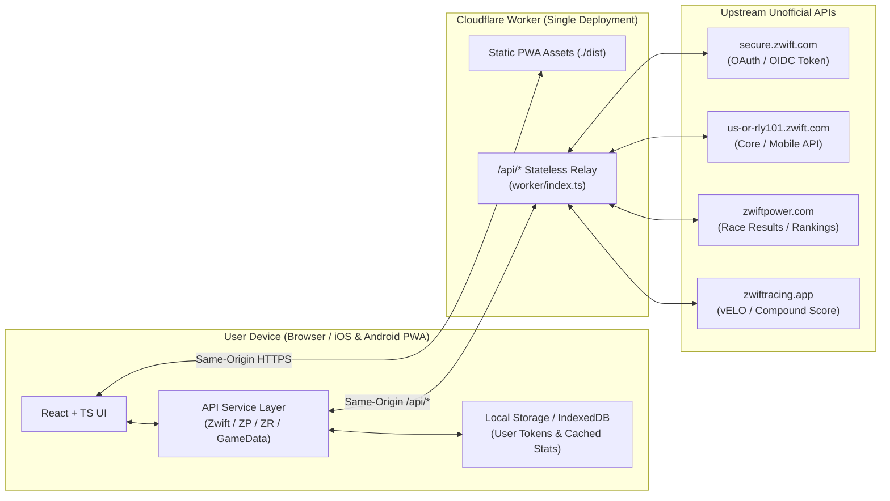

# Zwift-Victims: Architecture & Design Decisions

## 1. Project Vision & Goals
**Zwift-Victims** is an evolving, modular Progressive Web App (PWA) hosted on **Cloudflare Workers (with Static Assets)** for a group of friends who race and ride on Zwift.

The project begins with solving a specific pain point—**accurate pairwise Head-to-Head Win/Loss records against friends** (which ZwiftPower frequently miscalculates or omits)—and is architected so new Zwift tools and analytics (historical race deep-dives, bike/wheel equipment analysis, telemetry & `.fit` file inspection, route/segment comparisons, etc.) can be added incrementally without locking into a single API or data source.

### Core Requirements
- **All-in-One Cloudflare Hosting (`wrangler.jsonc`):** Both the React PWA static frontend (`./dist`) and the `/api/*` serverless relay (`worker/index.ts`) run on a single Cloudflare Worker deployment connected directly to this GitHub repository.
- **Installable PWA (iOS, Android, Desktop):** Uses a Web App Manifest and Service Worker (`vite-plugin-pwa`) so users can "Add to Home Screen" on iOS and Android for a native-like full-screen app experience.
- **User-Owned Authentication (No Shared/Hardcoded Credentials):** Users log in with their own Zwift credentials. Credentials are never stored on a server; session tokens live strictly on the user's own device (`localStorage` / `IndexedDB`).
- **Multi-Source API Architecture:** Built with a clean service abstraction layer so any feature/ticket can pull from **Zwift Core API**, **ZwiftPower**, **ZwiftRacing.app**, or **Static Game Data (Bikes/Frames/Wheels/Routes)** as needed.

---

## 2. System Architecture

### Why All-in-One Cloudflare (Static Assets + `/api/*` Worker)?
When a web browser attempts to call `secure.zwift.com`, `us-or-rly101.zwift.com`, or `zwiftpower.com` directly from client-side JavaScript, the browser blocks the response due to **CORS (Cross-Origin Resource Sharing)** restrictions and prevents JavaScript from reading cross-domain `Set-Cookie` headers required by ZwiftPower.

By hosting both our React PWA and our stateless API Worker on **Cloudflare** under the **same domain**:
1. **Zero Cross-Origin / CORS Hassle:** The frontend calls `/api/...` on its own origin (`same-origin`).
2. **Automatic GitHub CI/CD + Preview URLs:** Pushing to `main` deploys production automatically, and every Pull Request gets its own isolated preview URL.
3. **Stateless Cookie & Token Relay:** `worker/index.ts` intercepts `/api/*` requests, forwards them server-to-server to Zwift/ZwiftPower/ZwiftRacing, translates cookies/headers as needed, and serves static React assets (`env.ASSETS`) for all other routes.



---

## 3. Tech Stack Decisions

| Layer | Technology | Rationale |
| :--- | :--- | :--- |
| **Frontend Framework** | **React 19 + TypeScript + Vite 6** | Fast build times, strong typing for complex API payloads, easy modular expansion. |
| **Styling** | **Tailwind CSS v4** | Rapid responsive design optimized for both mobile (iOS/Android) and desktop dashboards. |
| **PWA Support** | **`vite-plugin-pwa`** | Auto-generates `manifest.webmanifest`, service workers, offline caching, and iOS/Android install metadata. |
| **Local Data Caching** | **`IndexedDB` / `localStorage`** | Prevents re-fetching historical races on every page load; avoids rate-limiting against Zwift/ZwiftPower. |
| **Hosting & API Relay** | **Cloudflare Workers with Static Assets (`wrangler.jsonc`)** | Unified hosting + 100,000 free API requests/day, zero cold-start latency, automatic GitHub deployments. |

---

## 4. Repository Structure

```text
Zwift-Victims/
├── docs/
│   ├── ARCHITECTURE.md       # System design, tech stack, and domain rules (this file)
│   └── API_REFERENCE.md      # Comprehensive guide to Zwift, ZwiftPower, ZwiftRacing & Game Data APIs
├── worker/
│   └── index.ts              # Cloudflare Worker handling /api/* routes + SPA static asset fallback
├── src/                      # Frontend PWA source code
│   ├── api/                  # Modular API clients (separated by upstream provider)
│   ├── domain/               # Pure business logic (e.g., Head-to-Head Win/Loss engine, exclusions)
│   ├── components/           # Shared UI components
│   ├── pages/                # Feature views (Login, Head-to-Head, Race Inspector, Garage/Equipment)
│   ├── App.tsx
│   └── main.tsx
├── wrangler.jsonc            # Unified Cloudflare Worker + Static Assets configuration
├── vite.config.ts            # Vite + React + Tailwind + PWA configuration
└── package.json
```

---

## 5. Core Domain Rules

### Feature 1: Head-to-Head (Win/Loss) Engine ("Zwift Victims")
ZwiftPower's native head-to-head and win-loss statistics often fail to count races accurately or misattribute wins. Our Head-to-Head engine enforces explicit, transparent rules:

1. **Pairwise Comparison (`1v1` Matrix within Multi-Friend Races):**
   - Whenever 2 or more tracked friends participate in the same race, **every pair of friends** generates a `1-0` / `0-1` result based on finishing order.
   - *Example:* In a race where **Friend B finishes 4th**, **Friend A finishes 5th**, and **User finishes 6th**:
     - **Friend B** goes `1-0` vs. Friend A, and `1-0` vs. User (`2-0` total from that event).
     - **Friend A** goes `0-1` vs. Friend B, and `1-0` vs. User (`1-1` total from that event).
     - **User** goes `0-1` vs. Friend B, and `0-1` vs. Friend A (`0-2` total from that event).
2. **Race Exclusions & Filters (Team Races, TTTs, Group Rides):**
   - **Team Events (e.g., ZRL / WTRL Team Time Trials or Points Races where friends ride as teammates):** Can be excluded automatically via event title/type tags (e.g. matching `ZRL`, `WTRL`, `TTT`) or toggled off via a manual "Exclude Race / Team Event" list.
   - **Category / Subgroup Options:** Support toggling whether comparisons apply only when racing in the **same category/subgroup** or across **overall event time**.


---

## 6. UX & Platform Decisions

### Long Screenshots & Shareable Views (In-App Share Feature)
Native OS scrolling screenshots (Android Pixel **"Capture more"** and iOS **Full Page** screenshots) do not work reliably for this app across mobile browsers (Chrome on Android) or installed Home Screen PWAs (`standalone` and `minimal-ui` display modes).

- **Decision:** Keep the PWA in `display: 'standalone'` mode so the installed app retains its native-like full-screen feel, and **build a dedicated in-app Share / Snapshot feature** once the core views (Head-to-Head tables, race comparisons, equipment summaries) are fleshed out.
- **Planned Implementation:** Render purpose-built, formatted summary cards or full-view images on-device (client-side DOM/Canvas-to-PNG export paired with the mobile Web Share API `navigator.share` / image download) so users can share clean snapshots to group chats from both iOS and Android, whether in a browser tab or the installed PWA.
