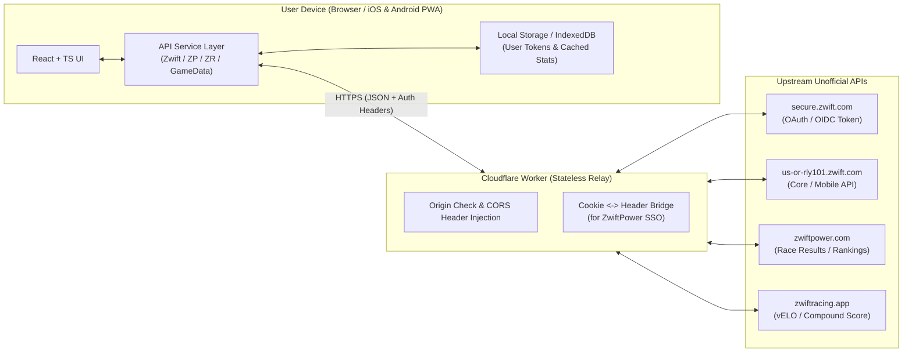

# Zwift-Victims: Architecture & Design Decisions

## 1. Project Vision & Goals
**Zwift-Victims** is an evolving, modular Progressive Web App (PWA) hosted on **GitHub Pages** for a group of friends who race and ride on Zwift. 

The project begins with solving a specific pain point—**accurate pairwise Head-to-Head Win/Loss records against friends** (which ZwiftPower frequently miscalculates or omits)—and is architected so new Zwift tools and analytics (historical race deep-dives, bike/wheel equipment analysis, telemetry & `.fit` file inspection, route/segment comparisons, etc.) can be added incrementally without locking into a single API or data source.

### Core Requirements
- **Hosted on GitHub Pages:** Free, static hosting directly from this repository.
- **Installable PWA (iOS, Android, Desktop):** Uses a Web App Manifest and Service Worker (`vite-plugin-pwa`) so users can "Add to Home Screen" on iOS and Android for a native-like full-screen app experience.
- **User-Owned Authentication (No Shared/Hardcoded Credentials):** Users log in with their own Zwift credentials. Credentials are never stored on a server; session tokens live strictly on the user's own device (`localStorage` / `IndexedDB`).
- **Multi-Source API Architecture:** Built with a clean service abstraction layer so any feature/ticket can pull from **Zwift Core API**, **ZwiftPower**, **ZwiftRacing.app**, or **Static Game Data (Bikes/Frames/Wheels/Routes)** as needed.

---

## 2. System Architecture

### Why a Serverless Proxy is Required
GitHub Pages serves static client-side files (`HTML`, `CSS`, `TS/JS`). When a web browser attempts to call `secure.zwift.com`, `us-or-rly101.zwift.com`, or `zwiftpower.com` directly from `https://<username>.github.io`, the browser blocks the response due to **CORS (Cross-Origin Resource Sharing)** restrictions, and prevents JavaScript from reading cross-domain `Set-Cookie` headers required by ZwiftPower.

### The Stateless Cloudflare Worker Relay
To solve CORS while keeping the app 100% free and stateless, we use a lightweight **Cloudflare Worker** (`worker/` directory in this repository) as a transparent relay.



#### Key Security Properties of the Proxy
1. **Zero Persistence:** The Cloudflare Worker has no database and logs no request bodies or headers. It forwards the request upstream and returns the response.
2. **Strict Origin Locking:** The Worker checks the `Origin` header and only responds to requests from the production GitHub Pages domain (`https://<username>.github.io`) and local development (`http://localhost:5173`).
3. **Client-Side Token Storage:** Once a user logs in, their Zwift JWT (`access_token` and `refresh_token`) is stored locally in their own browser storage and attached as an `Authorization: Bearer <token>` header on subsequent requests.

---

## 3. Tech Stack Decisions

| Layer | Technology | Rationale |
| :--- | :--- | :--- |
| **Frontend Framework** | **React + TypeScript + Vite** | Fast build times, strong typing for complex API payloads, easy modular expansion. |
| **Styling** | **Tailwind CSS** | Rapid responsive design optimized for both mobile (iOS/Android) and desktop dashboards. |
| **PWA Support** | **`vite-plugin-pwa`** | Auto-generates `manifest.webmanifest`, service workers, offline caching, and iOS/Android install metadata. |
| **Local Data Caching** | **`IndexedDB` (via `idb-keyval` or TanStack Query persistence)** | Prevents re-fetching historical races on every page load; avoids rate-limiting against Zwift/ZwiftPower. |
| **CORS / Auth Proxy** | **Cloudflare Workers (TypeScript / Wrangler)** | 100,000 free requests/day, zero cold-start latency, supports custom header/cookie translation. |
| **CI/CD** | **GitHub Actions** | Automatically builds and deploys the frontend to GitHub Pages on push to `main`. |

---

## 4. Repository Structure (Planned)

```text
Zwift-Victims/
├── docs/
│   ├── ARCHITECTURE.md       # System design, tech stack, and domain rules (this file)
│   └── API_REFERENCE.md      # Comprehensive guide to Zwift, ZwiftPower, ZwiftRacing & Game Data APIs
├── worker/                   # Cloudflare Worker stateless CORS & Auth proxy
│   ├── src/index.ts
│   └── wrangler.toml
├── src/                      # Frontend PWA source code
│   ├── api/                  # Modular API clients ( separated by upstream provider )
│   │   ├── zwiftCore.ts      # Official Zwift Mobile/Core API client
│   │   ├── zwiftPower.ts     # ZwiftPower JSON & table feed client
│   │   ├── zwiftRacing.ts    # ZwiftRacing.app client
│   │   └── gameData.ts       # Static bikes, wheels, frames, routes, and worlds lookup
│   ├── domain/               # Pure business logic (e.g., Head-to-Head Win/Loss engine, exclusions)
│   ├── components/           # Shared UI components
│   ├── pages/                # Feature views (Login, Head-to-Head, Race Inspector, Garage/Equipment)
│   └── types/                # TypeScript interfaces for API payloads
└── README.md
```

---

## 5. Core Domain Rules

### Feature 1: Head-to-Head (Win/Loss) Engine ("Zwift Victims")
ZwiftPower's native head-to-head and win-loss statistics often fail to count races accurately or misattribute wins. Our Head-to-Head engine enforces explicit, transparent rules:

1. **Pairwise Comparison (`1v1` Matrix within Multi-Friend Races):**
   - Whenever 2 or more tracked friends participate in the same race, **every pair of friends** generates a `1-0` / `0-1` result based on finishing order.
   - *Example:* In a race where **Friend B finishes 4th**, **Friend A finishes 5th**, and **User finishes 6th**:
     - **Friend B** goes `1-0` vs. Friend A, and `1-0` vs. User (`2-0` total from that event).
     - **Friend A** goes `0-1` vs. Friend B, and `1-0` vs. User (`1-1` total from that event).
     - **User** goes `0-1` vs. Friend B, and `0-1` vs. Friend A (`0-2` total from that event).
2. **Race Exclusions & Filters (Team Races, TTTs, Group Rides):**
   - Not all events should count toward individual head-to-head records.
   - **Rule-based & Manual Exclusions:**
     - **Team Events (e.g., ZRL / WTRL Team Time Trials or Points Races where friends ride as teammates):** Can be excluded automatically via event title/type tags (e.g. matching `ZRL`, `WTRL`, `TTT`) or toggled off via a manual "Exclude Race / Team Event" list.
     - **Category / Subgroup Options:** Support toggling whether comparisons apply only when racing in the **same category/subgroup** or across **overall event time**.

### Future Planned Modules
Because our `src/api/` layer separates providers cleanly, future tickets can combine multiple APIs:
- **Equipment & "What-If" Bike Analyzer:** Combine `zwiftCore` activity details (which contain `frameId` and `wheelId` equipped during the race) with static `gameData` (bike weight/aero CdA ratings) to see what bike each friend rode and calculate time differences.
- **Historical Race & Telemetry Deep-Dive:** Download `.fit` files or activity streams from `zwiftCore` alongside `zwiftPower` normalized power (`NP`), `20m/5m/1m/15s` power splits, and `zwiftRacing` vELO rating changes.
