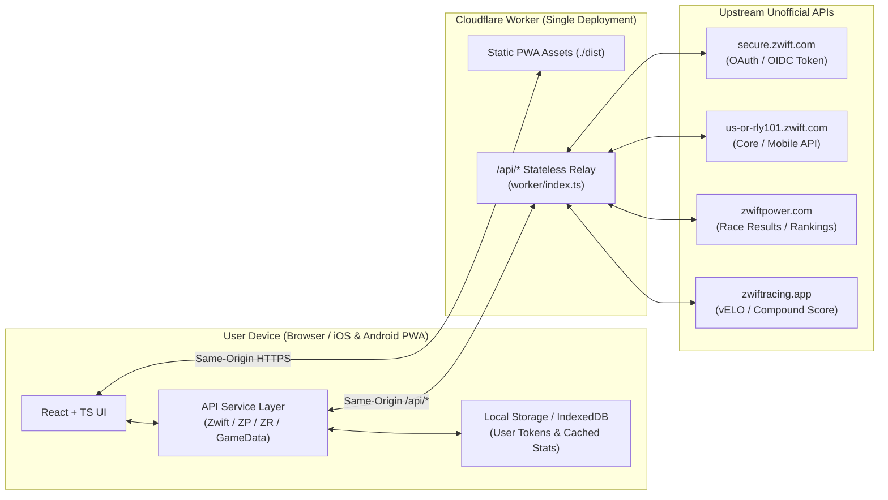

# Zwift-Victims: Architecture & Design Decisions

## 1. Project Vision & Goals
**Zwift-Victims** is an evolving, modular Progressive Web App (PWA) hosted on **Cloudflare Workers (with Static Assets)** for a group of friends who race and ride on Zwift.

The project begins with solving a specific pain point—**accurate pairwise Head-to-Head Win/Loss records against friends** (which ZwiftPower frequently miscalculates or omits)—and is architected so new Zwift tools and analytics (historical race deep-dives, bike/wheel equipment analysis, telemetry & `.fit` file inspection, route/segment comparisons, etc.) can be added incrementally without locking into a single API or data source.

### Core Requirements
- **All-in-One Cloudflare Hosting (`wrangler.jsonc`):** Both the React PWA static frontend (`./dist`) and the `/api/*` serverless relay (`worker/index.ts`) run on a single Cloudflare Worker deployment connected directly to this GitHub repository.
- **Installable PWA (iOS, Android, Desktop):** Uses a Web App Manifest and Service Worker (`vite-plugin-pwa`) so users can "Add to Home Screen" on iOS and Android for a native-like full-screen app experience.
- **User-Owned Authentication (No Shared/Hardcoded Credentials):** Users log in with their own Zwift credentials. Credentials are never stored on a server; session tokens live strictly on the user's own device (`localStorage` / `IndexedDB`).
- **Multi-Source API Architecture:** Built with a clean service abstraction layer so any feature/ticket can pull from **Zwift Core API**, **ZwiftPower**, **ZwiftRacing.app**, or **Static Game Data (Bikes/Frames/Wheels/Routes)** as needed.

---

## 2. System Architecture

### Why All-in-One Cloudflare (Static Assets + `/api/*` Worker)?
When a web browser attempts to call `secure.zwift.com`, `us-or-rly101.zwift.com`, or `zwiftpower.com` directly from client-side JavaScript, the browser blocks the response due to **CORS (Cross-Origin Resource Sharing)** restrictions and prevents JavaScript from reading cross-domain `Set-Cookie` headers required by ZwiftPower.

By hosting both our React PWA and our stateless API Worker on **Cloudflare** under the **same domain**:
1. **Zero Cross-Origin / CORS Hassle:** The frontend calls `/api/...` on its own origin (`same-origin`).
2. **Automatic GitHub CI/CD + Preview URLs:** Pushing to `main` deploys production automatically, and every Pull Request gets its own isolated preview URL. When a PR is closed/merged or its branch is deleted, [`.github/workflows/cleanup-preview.yml`](../.github/workflows/cleanup-preview.yml) automatically removes the branch's Worker Preview via `wrangler preview delete` (requiring `CLOUDFLARE_API_TOKEN` and `CLOUDFLARE_ACCOUNT_ID` GitHub Actions secrets).
3. **Stateless Cookie & Token Relay:** `worker/index.ts` intercepts `/api/*` requests, forwards them server-to-server to Zwift/ZwiftPower/ZwiftRacing, translates cookies/headers as needed, and serves static React assets (`env.ASSETS`) for all other routes.



---

## 3. Tech Stack Decisions

| Layer | Technology | Rationale |
| :--- | :--- | :--- |
| **Frontend Framework** | **React 19 + TypeScript + Vite 6** | Fast build times, strong typing for complex API payloads, easy modular expansion. |
| **Styling** | **Tailwind CSS v4** | Rapid responsive design optimized for both mobile (iOS/Android) and desktop dashboards. |
| **PWA Support** | **`vite-plugin-pwa`** | Auto-generates `manifest.webmanifest`, service workers, offline caching, and iOS/Android install metadata. |
| **Local Data Caching** | **`IndexedDB` / `localStorage`** | Prevents re-fetching historical races on every page load; avoids rate-limiting against Zwift/ZwiftPower. |
| **Hosting & API Relay** | **Cloudflare Workers with Static Assets (`wrangler.jsonc`)** | Unified hosting + 100,000 free API requests/day, zero cold-start latency, automatic GitHub deployments. |

---

## 4. Repository Structure

```text
Zwift-Victims/
├── docs/
│   ├── ARCHITECTURE.md       # System design, tech stack, and domain rules (this file)
│   └── API_REFERENCE.md      # Comprehensive guide to Zwift, ZwiftPower, ZwiftRacing & Game Data APIs
├── worker/
│   ├── index.ts              # Cloudflare Worker handling /api/* & /mcp routes + SPA static asset fallback
│   ├── mcp.ts                # Stateless Streamable HTTP JSON-RPC 2.0 transport (/mcp)
│   ├── mcpAuth.ts            # Split-key AES-256-GCM MCP token vault (MCP_TOKENS KV) & /api/mcp/tokens CRUD
│   ├── mcpTools.ts           # 6 read-only MCP tools with rider-ownership enforcement
│   ├── zwiftUpstream.ts      # Shared Zwift Core / ZwiftPower / ZwiftRacing / S3 FIT fetchers
│   └── seroval.ts            # Safe recursive-descent parser for ZwiftRacing SSR payloads
├── src/                      # Frontend PWA source code
│   ├── api/                  # Modular API clients (Zwift Core, ZP, ZR, MCP token management)
│   ├── auth/                 # AuthContext (session tokens & Zwift authentication state)
│   ├── components/           # Shared UI shell (AppShell), Connect AI/MCP modal & feature sections
│   ├── lib/                  # Domain logic, shared telemetryCore.ts, hooks, and contexts
│   ├── pages/                # Route views (HomePage [wrapper for "/" & "/riders/:riderId" → ProfilePage], ProfilePage, RaceHistoryPage, VictimsPage, RaceDetailPage, ActivityDetailPage, LoginPage)
│   ├── App.tsx               # React Router route definitions & global providers
│   └── main.tsx
├── wrangler.jsonc            # Unified Cloudflare Worker + Static Assets configuration
├── vite.config.ts            # Vite + React + Tailwind + PWA configuration
└── package.json
```

---

## 5. Core Domain Rules

### Feature 1: Head-to-Head (Win/Loss) Engine ("Zwift Victims")
ZwiftPower's native head-to-head and win-loss statistics often fail to count races accurately or misattribute wins. Our Head-to-Head engine enforces explicit, transparent rules:

1. **Pairwise Comparison (`1v1` Matrix within Multi-Friend Races):**
   - Whenever 2 or more tracked friends participate in the same race, **every pair of friends** generates a `1-0` / `0-1` result based on finishing order.
   - *Example:* In a race where **Friend B finishes 4th**, **Friend A finishes 5th**, and **User finishes 6th**:
     - **Friend B** goes `1-0` vs. Friend A, and `1-0` vs. User (`2-0` total from that event).
     - **Friend A** goes `0-1` vs. Friend B, and `1-0` vs. User (`1-1` total from that event).
     - **User** goes `0-1` vs. Friend B, and `0-1` vs. Friend A (`0-2` total from that event).
2. **Race Exclusions & Filters (Team Races, TTTs, Group Rides):**
   - **Team Events (e.g., ZRL / WTRL Team Time Trials or Points Races where friends ride as teammates):** Can be excluded automatically via event title/type tags (e.g. matching `ZRL`, `WTRL`, `TTT`) or toggled off via a manual "Exclude Race / Team Event" list.
   - **Category / Subgroup Options:** Support toggling whether comparisons apply only when racing in the **same category/subgroup** or across **overall event time**.

### Feature 2: Activity & Race History (At-a-Glance) vs. Event Detail (Click-In)

1. **Provider Roles for Activity & Race History:**
   - **ZwiftPower (`/cache3/profile/{id}_all.json`) — Primary Event Log:** Fast single fetch returning multi-year race and event history (`TYPE_RACE`, `TYPE_TT`, `TYPE_RIDE`, `TYPE_WORKOUT`) with power (`avg_power`, `np`), heart rate (`avg_hr`, `max_hr`), sprint/interval power (`w5`–`w1200`, `wkg5`–`wkg1200`), team (`tname`), `upg`, and penalties. *Caveat:* Drops private/non-ZwiftPower riders from standings, inflating category placings (`position_in_cat`) and sometimes reporting false podiums.
   - **ZwiftRacing.app (`zwiftracing.app/riders/{id}` SSR) — Standings & Rating Enrichment:** Preserves private riders in `place.positionInCategory` and `place.penTotal`, and adds course metadata (`routeName`, `elevation`, `subType`), vELO metrics (`before`, `after`, `expectedPosition`, `eventRating` SOF, 6-factor breakdown), and finish status (`didNotFinish`, `disqualified`). *Caveat:* Public history covers roughly the past ~90 days. (Rider-level ZR profile attributes such as overall vELO and phenotype belong to a separate Rider Profile ticket.)
   - **Zwift Core (`/api/profiles/{id}/activities`, `/api/activities/{id_str}`, `/api/public/events/{id}`, `/api/race-results/entries`) — Full Activity Feed & Click-In Event Detail:** Paginated `/api/profiles/{id}/activities` fetches (`start`/`limit` pages of 50, initially 100 activities with on-demand older paging) resolve 64-bit `id_str` links on ZwiftPower/ZwiftRacing events and surface standalone solo activities (free rides, workouts, pacer/group rides, runs) via `mergeActivities`, while `mergeRaces` keeps Head-to-Head (`ZwiftVictimsSection`) and `summarize()` strictly scoped to races. On the Race Detail view (`/riders/:riderId/races/:eventId` & `/races/:eventId`), Zwift Core supplies full activity details, `.fit` references (`fitFileBucket`/`fitFileKey`), screenshots (`primaryImageUrl`), calories, and **unfiltered finisher lists (`/api/race-results/entries?event_subgroup_id=...`) so races older than ZwiftRacing's ~90-day window still resolve true placings**.

2. **Attribute Tiers:**
   - **Tier 1 — At-a-Glance Activity & Race History Card + Quick Filter Bar:**
     - *Quick Filtering:* Type pills (`All` default, `Races`, `Group Rides`, `Workouts`, `Free Rides`) with counts and instant keyword search across title, route, category, team, event ID, and activity ID.
     - *Activity Classification & Placing Integrity:* Type pill (`Race`, `Time Trial`, `TTT`, `Group Ride`, `Workout`, `Free Ride`, `Run`), top-right Placing Badge (`truePlace / fieldSize` from ZwiftRacing when available; muted `zpPlace (ZP*)` fallback when unscored or >90 days old; `DNF`/`DQ`/penalty states), hidden-rider inflation callout (`ZP shows X — N better than reality`), and >90-day disclaimer.
     - *Identity & Subtitle:* `event_title` / `event.title` / `activity.name`, date (`event_date` / `event.time` / `activity.startDate`), `Cat {category}` (`subgroupId`), `subType`, `routeName` / world (`formatZwiftWorld`), `tname` (`Team`), `eventId` / `activityId`, `UPG`.
     - *Core Metrics Grid:* 12-tile race/event grid (`Time`, `Gap`, `Distance`, `Elevation`, `Avg Power`, `NP`, `Avg W/kg`, `Avg / Max HR`, `5s Sprint`, `vELO`, `Expected Pos`, `SOF`) or focused 6-tile standalone activity grid (`Time`, `Distance`, `Elevation`, `Avg Power`, `Avg W/kg`, `Avg / Max HR` or `Calories`).
     - *External Footer Links:* Footer icon links opening in a new window/tab when their required identifiers exist on the activity — ZwiftPower event (`zid`), ZwiftRacing.app event (`eventId` + `subgroup`), ZwifterBikes route (`routeName` slug), Zwift activity (`id_str`), ZwiftTools Bike Comparison (`?activity=<id_str>`), and ZwiftTools Race Replay (`?activity_id=<id_str>`).
   - **Tier 2 — Click-In Activity Detail Page (`/riders/:riderId/activities/:activityId` & `/activities/:activityId`):**
     - *Hero Summary, Gallery & Links:* `<ActivityTypeBadge />`, labeled external tool links (`RaceExternalLinks`), cross-link to `/riders/:riderId/races/:eventId` when `eventInfo` is present, activity description, snapshot photo gallery (`extractActivityPhotos`), and 12-tile `MetricGrid` (`Moving Time`, `Elapsed Time`, `Distance`, `Elevation`, `Avg Power`, `Max Power`, `Avg W/kg`, `Avg / Max Speed`, `Avg / Max HR`, `Avg / Max Cadence`, `Calories`, `Work`).
     - *Effort & Physiology Breakdown:* Power & FTP intensity zone progress bar (`% FTP`, Normalized Power, Activity FTP), Heart Rate & Aerobic Efficiency (`% Max HR`, `W/bpm`), and Pace & Climbing Density (`m/km` or `ft/mi`, `VAM`).
     - *Metadata & Event Context:* World, sport, timestamps, privacy, Ride Ons, comments, rider weight at activity time, and linked event context.
   - **Tier 2 — Click-In Race Detail Page (`/riders/:riderId/races/:eventId` & `/races/:eventId`):**
     - *Hero Summary, External Tool Links & Media:* Combined `PlacingBadge` + hidden-rider inflation callout (without the separate 3-box placing grid), labeled external tool links (`RaceExternalLinks` shared with Tier 1 via `RaceUi.tsx` for ZwiftPower, ZwiftRacing, ZwifterBikes, Zwift Activity, Bike Compare, and Race Replay), photo gallery (`primaryImageUrl`, `activitySnapshots`, `snapshots`, event banner), and a 12-tile summary `MetricGrid` (`Time`, `Gap`, `Distance`, `Elevation`, `Avg / NP`, `Max Power`, `Avg W/kg`, `Race FTP`, `Avg / Max Cadence`, `Race Weight`, `Calories`, `Moving Time`).
     - *Combined Event Standings:* One unified leaderboard per pen merging Zwift Core `/api/race-results/entries`, ZwiftRacing.app `/events/{eventId}` (`vELO`, `Δ`, course-weighted `Est. #`, `phenotype`, `avgSpeed`), and ZwiftPower `_view` & `_zwift` event results — highlighting the active rider, logged-in user, and favorited riders (`FavoritesContext`, gold shading + `★`), displaying ZRS vs. Category Enforcement pen ranges without buggy entrant counts, showing actual rider categories (`div`/`divw`, with progressive cached Zwift Core `/api/profiles/{riderId}` `competitionMetrics` fallback fetched only for visible page rows missing ZP categories) + ZRS scores, `Est. #` displaying a compact single-line estimate with click-to-toggle `Overall ⇄ Route` mode (persisted in `localStorage`, defaulting to Overall `expectedPosition` with beat delta and both Route/Overall/seed details in tooltip), `Speed` (Avg across field via ZR/distance÷time, Avg/Max for matched activity), self-explanatory two-line headers for dual-value/delta columns (`Est. #`, `ZRS`, `vELO`, `Splits`, `HR`, `Speed`), offering a `W | W/kg` splits toggle for `5s/1m/5m/20m`, pagination (`25 / 50 / 100` rows per page with a jump-to-rider shortcut), and persisting custom column visibility (`localStorage`, with `Team`, `Speed`, and `Status` defaulted off and `ZP #` / `Power Src` / `Cadence` omitted).
     - *Interactive Power Curve (`RacePowerCurve`):* Multi-rider SVG power curve (`5s`, `15s`, `30s`, `1m`, `2m`, `5m`, `20m`) with `W/kg | W` toggle, rider comparison selector (pen riders, Winner, Favorites, Pen Avg dashed reference), hover crosshair deltas, HR efficiency header badge, and interval comparison table.
     - *Ratings & Performance Impact (`RaceRatingsSection`):* Before → After movement cards for ZwiftRacing vELO, Zwift Racing Score (ZRS, with explicit ranked-event delta/no-delta messaging), ZwiftPower Race Ranking (with lower-is-better green/red direction), and vELO Legacy (v1), plus humanized terrain/skill factor adjustments (`factors.*`), click-to-toggle `Overall ⇄ Route` Expected vs. Actual finish (shared with standings `Est. #`, defaulting to `Overall`, with seed/range details in tooltip), true pen-averaged **Strength of Field (SOF)** with `Stronger` / `Average` / `Weaker` comparison badge, Intensity, and 1-decimal rounded ZwiftRacing leaderboard points (`value`, `gc`, `sprint`, `climb`, `tt`) / ZwiftPower league points.

### Feature 3: Activity Telemetry Export for Gemini / Claude
- **Multi-Activity Selection (`RaceHistoryPage`) & Single-Activity Export (`ActivityDetailPage`, `RaceDetailPage`):** Users can toggle **Select & Export** on the Activity & Race History feed to select multiple activities with a Zwift Core `activityId` (or launch export directly from any Activity Detail or matched Race Detail hero) via the shared [ActivityExportModal](../src/components/ActivityExportModal.tsx).
- **Telemetry Relay & Fallback (`worker/index.ts` → `src/lib/fitTelemetry.ts` & `src/lib/telemetryCore.ts`):** The Worker resolves authoritative `fitFileBucket`/`fitFileKey` or `fitnessData.fullDataUrl` coordinates from Zwift Core without trusting client-supplied URLs and without leaking OIDC Bearer tokens to S3/CloudFront. Pure FIT decoding (`@garmin/fitsdk`), `fitnessData` parsing, and resampling live in shared [telemetryCore.ts](../src/lib/telemetryCore.ts) (used by both browser exports and the remote MCP Worker). The browser packages RFC-4180 CSVs, combined multi-activity CSVs, raw `.fit` files, `fflate`-compressed `.zip` archives, Web Share handoffs, and Markdown summaries.

### Feature 4: Remote MCP Server (`/mcp`)
- **Stateless Streamable HTTP (`worker/mcp.ts`):** Exposes 6 read-only MCP tools (`get_activities`, `get_activity_detail`, `get_activity_stream`, `get_power_curve`, `get_race_results`, `get_intervals`) over `/mcp` so Gemini CLI, Claude Code, and Claude Desktop (`mcp-remote`) can query the signed-in rider's Zwift data on demand.
- **Per-User Split-Key KV Auth (`worker/mcpAuth.ts`):** Signed-in users mint and revoke personal tokens (`zv_mcp_<tokenId>.<secret>`) from the **Connect AI / MCP** modal (utility menu / drawer + own Profile overview). Zwift OIDC tokens are encrypted at rest in optional Cloudflare KV (`MCP_TOKENS`) using AES-256-GCM keyed by the client-held `secret`, so neither raw Zwift credentials nor unencrypted OIDC tokens are ever persisted in KV.

---

## 6. UX & Platform Decisions

### Long Screenshots & Shareable Views (In-App Share Feature)
Native OS scrolling screenshots (Android Pixel **"Capture more"** and iOS **Full Page** screenshots) do not work reliably for this app across mobile browsers (Chrome on Android) or installed Home Screen PWAs (`standalone` and `minimal-ui` display modes).

- **Decision:** Keep the PWA in `display: 'standalone'` mode so the installed app retains its native-like full-screen feel, and **build a dedicated in-app Share / Snapshot feature** once the core views (Head-to-Head tables, race comparisons, equipment summaries) are fleshed out.
- **Planned Implementation:** Render purpose-built, formatted summary cards or full-view images on-device (client-side DOM/Canvas-to-PNG export paired with the mobile Web Share API `navigator.share` / image download) so users can share clean snapshots to group chats from both iOS and Android, whether in a browser tab or the installed PWA.
